# Automated Testing

Learn about the various kinds of automated tests.

<!-- START doctoc generated TOC please keep comment here to allow auto update -->
<!-- DON'T EDIT THIS SECTION, INSTEAD RE-RUN doctoc TO UPDATE -->

- [What is automated testing?](#what-is-automated-testing)
  - [Manual testing](#manual-testing)
    - [Quality assurance](#quality-assurance)
  - [Automated testing](#automated-testing)
  - [Automated vs. manual](#automated-vs-manual)
  - [Test frameworks](#test-frameworks)
    - [Which test framework should I use?](#which-test-framework-should-i-use)
  - [Types of automated tests](#types-of-automated-tests)
    - [The test pyramid](#the-test-pyramid)
  - [Yet another classification](#yet-another-classification)
- [Unit tests](#unit-tests)
  - [What is a unit test?](#what-is-a-unit-test)
  - [How to write a unit test](#how-to-write-a-unit-test)
  - [Assertions](#assertions)
  - [An implementation in JavaScript](#an-implementation-in-javascript)
  - [Arrange, Act, Assert](#arrange-act-assert)
  - [Why write unit tests?](#why-write-unit-tests)
    - [Disadvantages of unit tests](#disadvantages-of-unit-tests)
- [Integration tests](#integration-tests)
  - [Advantages and disadvantages of integration testing](#advantages-and-disadvantages-of-integration-testing)
  - [Test doubles](#test-doubles)
- [API tests](#api-tests)
  - [How to write an API test](#how-to-write-an-api-test)
  - [How an API test runs](#how-an-api-test-runs)
  - [Benefits of API tests](#benefits-of-api-tests)
- [System tests](#system-tests)
  - [Advantages and disadvantages of system testing](#advantages-and-disadvantages-of-system-testing)
- [Writing good tests](#writing-good-tests)
  - [What makes a good test](#what-makes-a-good-test)
  - [Code coverage](#code-coverage)
    - [What coverage does not tell you](#what-coverage-does-not-tell-you)
- [Ok, but...](#ok-but)
  - [The benefits of automated tests](#the-benefits-of-automated-tests)
  - [All green!](#all-green)
  - [Running tests automatically](#running-tests-automatically)
- [Test-Driven Development (TDD)](#test-driven-development-tdd)
  - [What is test-driven development?](#what-is-test-driven-development)
  - [Why on earth would I do that?](#why-on-earth-would-i-do-that)
- [Testing in the age of AI](#testing-in-the-age-of-ai)
  - [Why tests matter even more](#why-tests-matter-even-more)
  - [Working with an AI assistant](#working-with-an-ai-assistant)
- [Going further](#going-further)
- [References](#references)

<!-- END doctoc generated TOC please keep comment here to allow auto update -->

## What is automated testing?

<!-- slide-front-matter class: center, middle -->

<p class='center'></p>

### Manual testing

<!-- slide-column -->

When writing or modifying software, especially large software, you must
regularly **test** it to make sure it works. **Manual testing** is basically
testing the software yourself, whether it's a desktop or mobile application, or
a website. You'll browse through the pages or screens, fill and submit forms,
trigger actions, etc.

<!-- slide-column -->

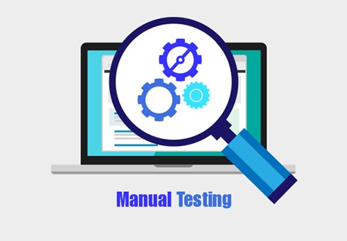

#### Quality assurance

In a large company, this might be handled by specialized [Quality Assurance
(QA)][qa] engineers. Whether you or a QA engineer is doing it, manual testing
has certain disadvantages:

<!-- slide-column -->

- It is **time-consuming**. Testing a large software application manually can
  take hours or even days. You might skip some tests to save time, allowing bugs
  to stay hidden.
- It is **boring** and **repetitive**. This makes it more likely that you will
  make a mistake while testing and miss a bug.

<!-- slide-column 30 -->


### Automated testing

<!-- slide-column -->

Running functions, making HTTP calls or clicking on specific buttons does not
have to be done by a human being. A program can do it just as well, _and it will
never get bored doing it_.

<!-- slide-column 35 -->


<!-- slide-container -->

[**Test automation**][automated-tests] is the use of special **testing
software**:

- The test software is **separate from the software being tested**.
- It **executes tests automatically** instead of manually.
- It compares **actual outcomes** (what actually happens) versus **expected**
  outcomes (what you expected to happen when writing the test).

### Automated vs. manual

<!-- slide-column -->

**Automated tests are not a replacement for manual tests**. They are
complementary in that they can be used to accelerate or automate tests that can
be run by a machine instead of a human. But an automated test cannot think.

Manual testers still have their place, but are better employed running complex
or hard-to-reproduce tests which actually require a human being at the wheel, or
finding ways to break your application.

<!-- slide-column -->

<p class='center'></p>

### Test frameworks

There are many **test runners**, written in various languages, which you can
use to write and execute tests:

| Test runners                                                                     | Tests written in               |
| :------------------------------------------------------------------------------- | :----------------------------- |
| [Node.js test runner][node-test], [Vitest][vitest], [Jest][jest], [Mocha][mocha] | [JavaScript][js]               |
| [JUnit][junit], [kotlin.test][kotlin.test]                                       | [Java][java], [Kotlin][kotlin] |
| [PHPUnit][phpunit], [Pest][pest]                                                 | [PHP][php]                     |
| [pytest][pytest], [unittest][python-unittest]                                    | [Python][python]               |
| [RSpec][rspec], [Minitest][minitest]                                             | [Ruby][ruby]                   |
| [`go test`][go-test]                                                             | [Go][go]                       |
| [Swift Testing][swift-testing]                                                   | [Swift][swift]                 |
| [ExUnit][exunit]                                                                 | [Elixir][elixir]               |

#### Which test framework should I use?

It depends on what kind of test you want to write.

**If you want to test an individual function**, a PHP function for example, you
must use a **test framework written in the same language**, such as
[PHPUnit][phpunit].

However, **if you want to test an API** or drive a mobile application or
website, **it does not matter in which language the testing tool is written**,
as long as it can make the required HTTP calls or click on the correct buttons:

| Tools used in tests                                                                    | What they do                                  |
| :------------------------------------------------------------------------------------- | :-------------------------------------------- |
| [SuperTest][supertest]                                                                 | Make HTTP requests to an API, check responses |
| [Playwright][playwright], [Cypress][cypress], [Selenium WebDriver][selenium-webdriver] | Drive a browser like a user would             |
| [Appium][appium]                                                                       | Drive a mobile application                    |
| [k6][k6], [JMeter][jmeter]                                                             | Load and performance tests                    |

For example, [SuperTest][supertest] is written in JavaScript, but it could be
used to test an API implemented in PHP with Laravel.

### Types of automated tests

There are various types of automated tests, and some of these types overlap. Not
everybody agrees how they should be called:

<!-- slide-column -->

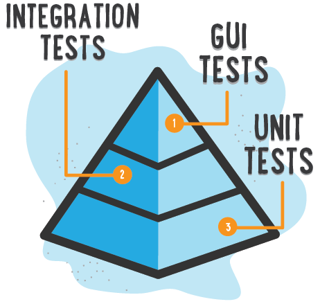

<!-- slide-column -->

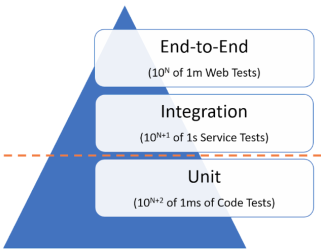

<!-- slide-column -->

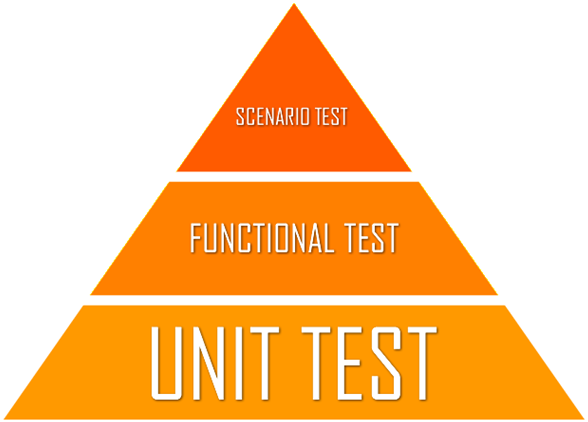

#### The test pyramid

<!-- slide-column -->

Whatever the names, these diagrams share a shape, the **test pyramid**. It tells
you how many tests of each kind to write:

- **Many unit tests** at the bottom. They are fast and cheap to write, and when
  one fails, you know exactly where the problem is.
- **Fewer integration tests** in the middle.
- **Few system tests** at the top. They are slow, brittle and hard to debug, but
  they are the only ones that check the whole system.

The higher you go, the more **confidence** each test gives you, and the more it
**costs** to write, run and maintain.

<!-- slide-column 35 -->


<!-- slide-container -->

> Many REST APIs mostly validate, store and return data. For them, **API
> tests** give you the most confidence for the effort, which is why the
> [testing trophy][testing-trophy] variant makes the middle layer the widest.

### Yet another classification

This is one way to look at the different types of tests:

| Type                                     | What is tested                                                                              | Properties                   |
| :--------------------------------------- | :------------------------------------------------------------------------------------------ | :--------------------------- |
| [Unit tests][unit-testing]               | Things in isolation                                                                         | Fastest, easiest to maintain |
| [Integration tests][integration-testing] | A number of things plugged together                                                         |                              |
| [System tests][system-testing]           | Whole system from the user's perspective, often through the GUI; also known as "end-to-end" | Slower, harder to maintain   |

> There are also other specialized types of tests, like [API tests][api-testing]
> which are used to test REST APIs; or [performance tests][performance-testing]
> which can be used to test the response time or scalability of software and
> infrastructure. You could consider they are a subtype of integration and
> system tests.

## Unit tests

<!-- slide-front-matter class: center, middle -->

<p class='center'>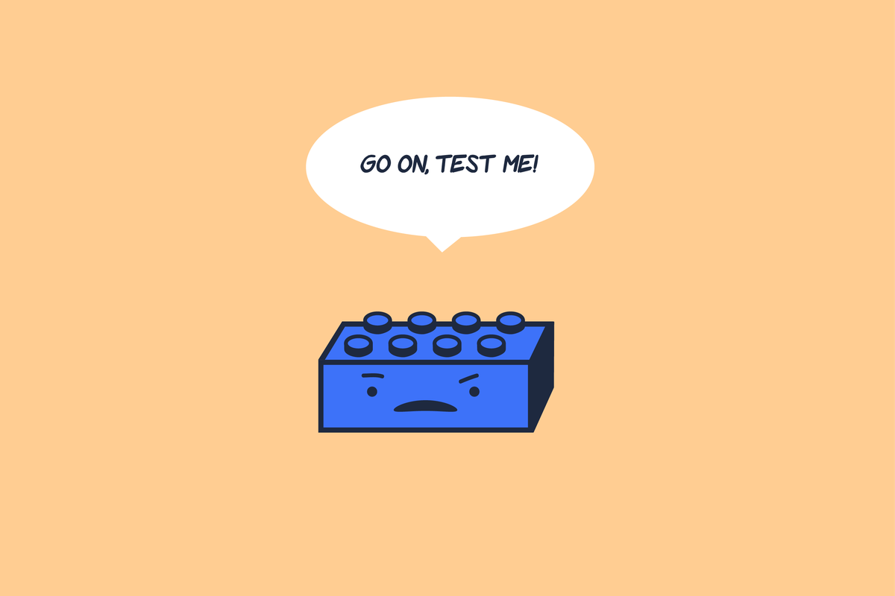</p>

### What is a unit test?

The goal of [unit testing][unit-testing] is to test **individual units of source
code in isolation**. You can view a **unit** as the **smallest testable part of
your software**.

<p class='center'>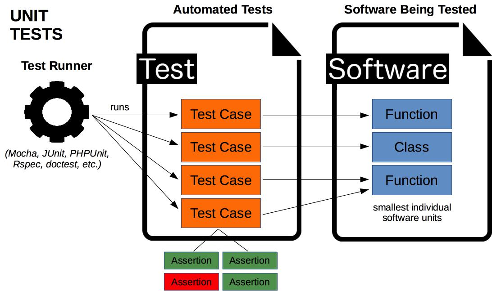</p>

### How to write a unit test

For example, you might test an individual JavaScript function.

```js
export function add(a, b) {
  return a + b;
}
```

When writing a unit test for a piece of code, you want to identify the
**inputs** and **outputs** (or side effects) of that code. In this case:

- There are **two numbers as inputs**, `a` and `b`.
- There is **one number as output**.

### Assertions

Once you have the inputs and outputs, you want to define **assertions** on how
that code should behave.

```js
export function add(a, b) {
  return a + b;
}
```

Assertions are the outputs you expect for specific inputs.
For example:

- For inputs 2 and 3, the **expected** output is 5.
- For inputs -3 and 4, the **expected** output is 1.
- For inputs 10 and -12, the **expected** output is -2.

When implementing unit tests, you will execute the code and use assertions to
compare the **actual** output value with the **expected** one.

### An implementation in JavaScript

For example, this is how you could write those assertions with the [test
runner][node-test] and the [assertion module][node-assert] built into Node.js:

```js
import assert from 'node:assert/strict';
import { describe, test } from 'node:test';

import { add } from './math.js';

describe('add', function () {
  test('should add two numbers together', function () {
*   const actual = add(2, 3);
*   const expected = 5;
*   assert.equal(actual, expected);
  });

  test('should add a positive number to a negative number', function () {
    assert.equal(add(-3, 4), 1);
  });

  test('should add a negative number to a positive number', function () {
    assert.equal(add(10, -12), -2);
  });
});
```

Run it with `node --test`.

### Arrange, Act, Assert

Most tests follow the same three steps:

1. **Arrange**: set up the inputs and the state that the code needs.
2. **Act**: execute the code you are testing.
3. **Assert**: compare the actual result with the expected one.

<!-- slide-column -->

```js
test('adds 2 and 3', function () {
  // Arrange
  const a = 2;
  const b = 3;

  // Act
  const actual = add(a, b);

  // Assert
  assert.equal(actual, 5);
});
```

<!-- slide-column -->

<!-- prettier-ignore-start -->

```js
it('POST /users', async function () {
  // Arrange (empty database)
  await cleanUpDatabase();

  // Act
  const res = await supertest(app)
    .post('/users')
    .send({ name: 'John Doe' });

  // Assert
  assert.equal(res.status, 201);
});
```

<!-- prettier-ignore-end -->

<!-- slide-container -->

> The same structure is called **Given, When, Then** in [Behavior-Driven
> Development][bdd]. The second example is an API test: more on those later.

### Why write unit tests?

Unit tests allow you to isolate each part of a program and **check that each
individual part behaves as expected**, for the cases you have written.

They act as a strict, written **contract** that the code must satisfy. By
testing the parts of a program first and then testing the sum of its parts,
integration testing becomes much easier.

> "Program testing can be used to show the presence of bugs, but never to show
> their absence!" – Edsger W. Dijkstra

#### Disadvantages of unit tests

Unit tests **will not catch every error in the program**, because they cannot
evaluate every execution path in any but the most trivial programs. [They will
not catch integration
errors](https://www.simscale.com/blog/nasa-mars-climate-orbiter-metric/) or
broader system-level errors.

Software testing is a combinatorial problem: the number of possible execution
paths **grows exponentially** with the number of branches (`if`, `switch`, …).
You cannot test them all, so you must choose which cases matter.

To obtain the intended benefits from unit testing, rigorous discipline is needed
throughout the software development process. You must keep track of which tests
have been written already, which are missing, and ensure that failures are
reviewed and addressed immediately.

## Integration tests

When doing integration tests, individual software **units are combined and
tested as a group**. This **ensures that components work well together**, not
only individually as tested by unit tests.

<p class='center'>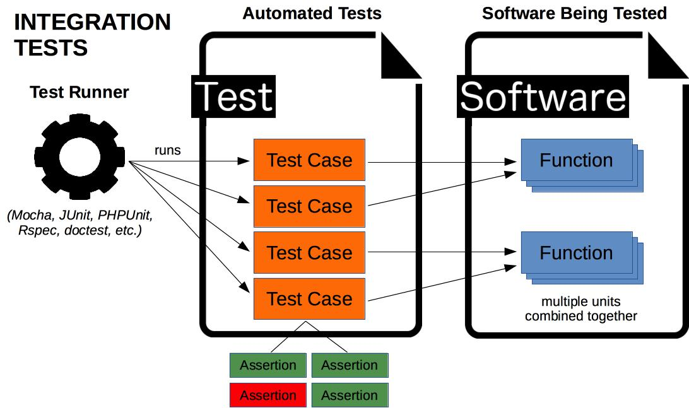</p>

### Advantages and disadvantages of integration testing

**Advantages**

- Integration tests help **discover interfacing problems** between components.
- Integration tests **catch system-level issues**, such as miscommunication,
  broken database schema, mistaken cache integration, and so on, which might be
  difficult to identify with unit tests.

**Disadvantages**

- **Finding bugs is more difficult** than with unit tests. When an integration
  test fails, since multiple components are combined, it may be unclear which
  one is causing the bug.
- Integration tests are **more complex and harder to write** than unit tests by
  definition, since they combine multiple components.

### Test doubles

Some components cannot (or should not) be used in a test: a payment service that
charges real money, an email server, a slow or rate-limited third-party API, the
current date… You can replace them with a [**test double**][test-double], a
stand-in that looks the same to the code being tested:

| Kind     | What it does                                | Example                                             |
| :------- | :------------------------------------------ | :-------------------------------------------------- |
| **Stub** | Returns predefined answers                  | A weather API that always says "sunny"              |
| **Mock** | Records how it was called, so you can check | An email sender: "was 1 email sent to `jdoe@…`?"    |
| **Fake** | A simpler, working implementation           | An array in memory instead of a database collection |

> When your database queries _are_ your API's logic, **do not replace the
> database**: test them against a real test database. If you want a throwaway
> one, [MongoDB Memory Server][mongodb-memory-server] starts a temporary MongoDB
> server for your tests. For anything else, the Node.js test runner has a
> [`mock`][node-test-mocking] API.

## API tests

[API testing][api-testing] involves **testing application programming interfaces
(APIs)** directly to **determine if they meet expectations** for functionality,
reliability, performance and security.

For example, your application may provide a [RESTful][rest] API or an [RPC][rpc]
API accessible over the Internet. Automated tests can make HTTP calls to these
APIs and compare actual outcomes with expected outcomes.

> **API tests can be considered a type of integration test** since they test
> multiple components of your API working together.

### How to write an API test

The tools used to write API tests are often the same as for unit tests. You
might need additional tools depending on the type of test. For example, when
testing a REST API, you will need to make HTTP requests somehow.

But the basic principle is the same as for unit tests:

- Think about the inputs (HTTP request) and outputs (HTTP response, database
  changes, etc) of an API operation. In other words, define the **expected**
  result of the operation.
- Perform that API operation (make the HTTP request and retrieve the response).
  In other words, get the **actual** result.
- Make **assertions** to check that the actual result is as expected.

### How an API test runs

<p class='center'>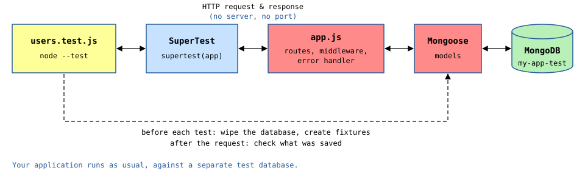</p>

- [SuperTest][supertest] calls your Express application **directly**: there is
  no server to start, no port to open.
- Your application runs **as usual**, with your real routes, middleware and
  Mongoose models.
- It uses a **separate test database**, which your tests wipe and fill with
  known data before each test.

> The [guide][guide] shows how to set all of this up.

### Benefits of API tests

Your API **is** the interface of your application: it is what your clients, such
as a mobile or web application, actually use. Testing it through HTTP checks
exactly what they will see.

API tests are also easier to maintain than end-to-end tests through a user
interface, which tend to break whenever the interface changes.

<p class='center'>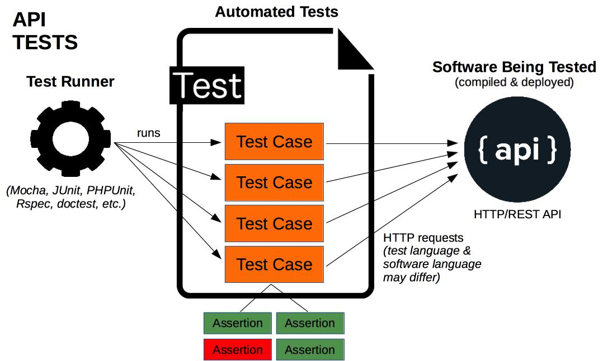</p>

## System tests

[System tests][system-testing], often end-to-end [Graphical User Interface (GUI)
tests][gui-testing], are focused on testing the whole system from the user's
perspective.

<p class='center'>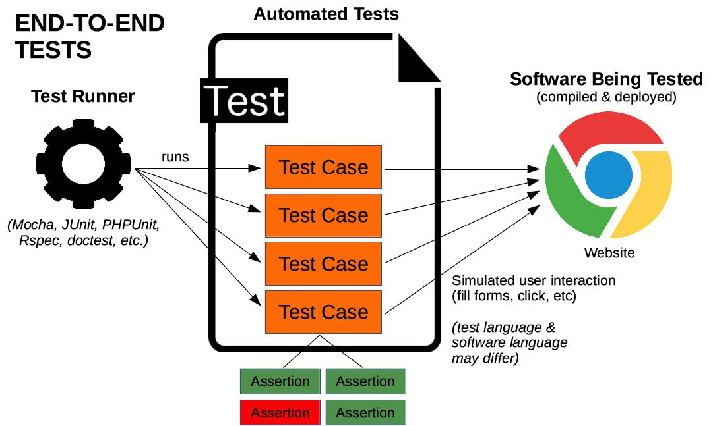</p>

For example, testing tools like [Playwright][playwright] or [Selenium
WebDriver][selenium-webdriver] allow you to control a browser and simulate a
user by navigating to web pages, filling forms, clicking buttons, etc.

### Advantages and disadvantages of system testing

**Advantages**

- System tests are the only type of test that check that **your entire system
  works as expected**.
- System tests are the tests that **correspond the most to what your users are
  actually doing**.

**Disadvantages**

- System tests tend to be **complex** in that they require the whole system to
  be properly set up for each test. Also, when an error occurs, it might not be
  clear where exactly in the system it originated from.
- Since system tests are often performed through the GUI, they also tend to be
  **brittle**: they may break easily due to minor UI changes.

## Writing good tests

<!-- slide-front-matter class: center, middle -->

What makes a test worth having?

### What makes a good test

| A good test is…  | Which means…                                                                  | For example                                                             |
| :--------------- | :---------------------------------------------------------------------------- | :---------------------------------------------------------------------- |
| **Reproducible** | It gives the same result every time it runs                                   | Running `npm test` twice in a row passes both times                     |
| **Independent**  | It sets up its own data, and does not depend on other tests or on their order | It creates the users it needs instead of using those of a previous test |
| **Focused**      | It checks one behavior                                                        | `POST /users` and `GET /users` are tested separately                    |
| **Thorough**     | It covers what can go wrong, not only what goes right                         | It also tests a duplicate name, invalid data, a missing resource        |

> A test that sometimes passes and sometimes fails for no apparent reason is
> **flaky**. Fix it or delete it: a test that nobody trusts is soon ignored, and
> so are the real failures it hides.

### Code coverage

**Code coverage** measures how much of your code is **executed** by your tests:

<!-- slide-column -->

```js
export function shippingCost(order) {
  if (order.total >= 100) {
    return 0;
  }
  return 10;
}
```

<!-- slide-column -->

- **Line coverage**: which lines ran at least once.
- **Branch coverage**: which sides of each `if`, `switch`… were taken.

<!-- slide-container -->

```js
test('shipping is free from 100', function () {
  assert.equal(shippingCost({ total: 150 }), 0);
});
```

```
$> node --test --experimental-test-coverage
...
file        | line % | branch % | funcs % | uncovered lines
shipping.js |  83.33 |    66.67 |  100.00 | 5
```

Line 5 (`return 10`) never ran: no test has an order **under 100**. The report
tells you **where tests are missing**.

#### What coverage does not tell you

Coverage tells you which code was **executed**, not whether it was **checked**.
A test without any assertion can still cover every line:

```js
test('shipping', function () {
  shippingCost({ total: 150 });
  shippingCost({ total: 50 });
});
```

It is rarely worth aiming for 100%: the last few percent are often error
handlers for situations that are hard to reproduce.

> A minimum coverage is a useful safety net, but do not chase the number for its
> own sake. As [Goodhart's law][goodhart] puts it: "when a measure becomes a
> target, it ceases to be a good measure."

## Ok, but...

<!-- slide-front-matter class: center, middle -->

<p class='center'></p>

Why take the time and effort to write tests?

### The benefits of automated tests

Automated tests **find problems early in the development cycle**. Writing tests
forces you to think through inputs, outputs and error conditions, and thus to
define more crisply what your program should do. A bug costs much less to fix
when the code has just been written than when it is found months later.

Automated tests provide a sort of **living documentation** of the system:
looking at a program's tests can give a basic understanding of its interface.

When you’re in it for the long haul, the effort of implementation will
eventually be insignificant compared to the cumulated effort of maintenance.
Therefore:

> "It is more important to reduce the effort of maintenance than it is to reduce
> the effort of implementation." – [Code
> Simplicity](https://www.oreilly.com/library/view/code-simplicity/9781449314750/)

Tests help you **ensure your system keeps working over time**, especially when
making changes.

### All green!

Having a good automated test suite **prevents
[regression][regression-testing]**.

Imagine you had a [magic button](https://youtu.be/GZL8-Ywq9qg?feature=shared)
which you can push to check whether everything in the system is still working.
It might help someone who is not familiar with the code (**that could be you in
6 months**) to know that they have not broken the system after making a change.

**Having a good test suite removes fear:** the fear of breaking your system. It
enables you to move forward and to clean your code whenever you choose, thereby
improving quality, because you can easily check that everything still works.

### Running tests automatically

A test suite only protects you if it is **run**. [**Continuous
integration**][ci] (CI) runs it automatically every time someone pushes to the
repository, for example with [GitHub Actions][github-actions]:

- Everyone knows right away when a change breaks something.
- A red cross next to a commit is hard to ignore.

> **This consumes the GitHub Actions minutes of the owner of the repository.**
> GitHub only includes a limited amount of Actions usage for **private**
> repositories. Every run is charged to the account that **owns** the
> repository, whoever pushed: in a team, everyone's pushes use the owner's
> minutes. Read the [guide][guide-ci] and agree with your team before setting it
> up.

## Test-Driven Development (TDD)

<!-- slide-front-matter class: center, middle -->

<p class='center'>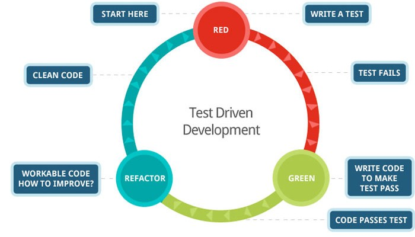</p>

### What is test-driven development?

As the name implies, [**t**est-**d**riven **d**evelopment (TDD)][tdd] is
**driven by tests**. When you want to add a new feature to your software,
instead of developing your code first, then writing your tests, you use this
process, called **red, green, refactor**:

1. 🔴 **Red**: first, **write a failing test** for the feature.

   > The test will always fail at first because the feature does not exist yet.
   > You do not have to write a complete test either. Just enough to make it
   > fail.

1. 🟢 **Green**: then, **implement the necessary code** until your test
   succeeds.

   > You do not have to implement the complete feature. Just enough to make your
   > test pass.

1. 🔵 **Refactor**: finally, **improve your code** if possible and if necessary,
   while the tests keep passing.

Continue this process until the feature is finalized.

### Why on earth would I do that?

<!-- slide-column -->

Imagine that you are always working with this process. **At any given point in
time, virtually all your code is covered by automated tests.** The only code
that may not yet be fully tested is the one you have been working on during the
last 15 minutes.

You will end up with a very high-quality test suite.

In other words, TDD will help you get _the magic button_. The one that lets you
check that everything works whenever you want.

<!-- slide-column 45 -->

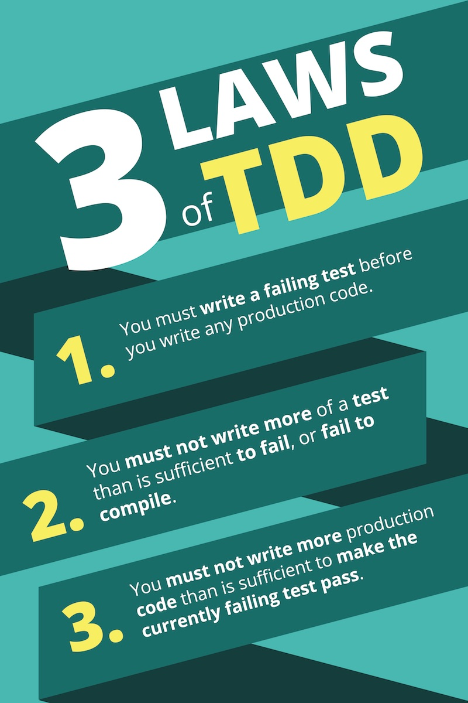

## Testing in the age of AI

<!-- slide-front-matter class: center, middle -->

When code is cheap to write, knowing that it works is what matters.

### Why tests matter even more

AI coding assistants and agents can write a lot of code, fast. But:

- **You did not write it**, so you understand it less than your own code, and
  reviewing all of it carefully takes time.
- **It always looks plausible**, even when it is wrong: a missed edge case, a
  function or option that does not exist, an outdated way of doing things.
- **Every change can break something else**, and an assistant changes code
  readily, sometimes far from where you asked.

Automated tests let you **check instead of trust**: they turn "this looks
right" into "this works for these cases", every time the code changes.

They also help the assistant itself. An agent that can **run your tests** can
see what it broke and fix it. Without tests, it can only guess.

### Working with an AI assistant

- **Your tests are your specification**: write them yourself, or at least read
  them carefully, since they say what the code must do.
- **Watch the tests too**: to make a failing test pass, an assistant may change
  the test instead of the code, weaken an assertion, or mock the very thing
  being tested.
- **Beware of tests that cannot fail**: no assertion, or expected values copied
  from whatever the code currently returns.
- **TDD fits well**: write a failing test that describes the behavior you want,
  ask the assistant to make it pass, then review the change.
- **Keep the regression suite**: regenerating code is cheap, but knowing that
  everything still works after it is not.

## Going further

- [Set up automated testing for an Express.js REST API][guide]
- [Node.js test runner][node-test] and [`node:assert`][node-assert]
- [SuperTest][supertest]
- [Playwright][playwright], to test a web application in a browser

## References

- [Test Automation][automated-tests]
  - [Unit Testing][unit-testing]
  - [Integration Testing][integration-testing]
  - [System Testing][system-testing]
  - [API Testing][api-testing]
  - [GUI Testing][gui-testing]
  - [Performance Testing][performance-testing]
- [Martin Fowler - Test Pyramid](https://martinfowler.com/bliki/TestPyramid.html), [The Practical Test Pyramid](https://martinfowler.com/articles/practical-test-pyramid.html)
- [Kent C. Dodds - The Testing Trophy][testing-trophy], [Martin Fowler - Test Double][test-double]
- [Smartbear - Automated Testing](https://smartbear.com/learn/automated-testing/)
- [Atlassian CI/CD - Types of Software Testing](https://www.atlassian.com/continuous-delivery/software-testing/types-of-software-testing)
- [Test-Driven Development](https://en.wikipedia.org/wiki/Test-driven_development)
  - [_YouTube:_ Expecting Professionalism – Robert C. Martin](https://youtu.be/BSaAMQVq01E)
  - [_YouTube:_ GOTO 2017 – The Scribe's Oath – Robert C. Martin](https://youtu.be/Tng6Fox8EfI)
  - [_YouTube:_ The Future of Programming – Robert C. Martin](https://youtu.be/ecIWPzGEbFc)

[api-testing]: https://en.wikipedia.org/wiki/API_testing
[appium]: https://appium.io
[automated-tests]: https://en.wikipedia.org/wiki/Test_automation
[bdd]: https://en.wikipedia.org/wiki/Behavior-driven_development
[ci]: https://en.wikipedia.org/wiki/Continuous_integration
[cypress]: https://www.cypress.io
[elixir]: https://elixir-lang.org
[exunit]: https://hexdocs.pm/ex_unit/ExUnit.html
[github-actions]: https://docs.github.com/en/actions/get-started/quickstart
[go]: https://go.dev
[go-test]: https://pkg.go.dev/testing
[goodhart]: https://en.wikipedia.org/wiki/Goodhart%27s_law
[guide]: https://github.com/MediaComem/comem-archioweb/blob/main/guides/set-up-automated-tests.md
[guide-ci]: https://github.com/MediaComem/comem-archioweb/blob/main/guides/set-up-automated-tests.md#optional-run-your-tests-on-every-push
[gui-testing]: https://en.wikipedia.org/wiki/Graphical_user_interface_testing
[integration-testing]: https://en.wikipedia.org/wiki/Integration_testing
[java]: https://www.java.com
[jest]: https://jestjs.io
[jmeter]: https://jmeter.apache.org
[js]: https://en.wikipedia.org/wiki/JavaScript
[junit]: https://junit.org
[k6]: https://grafana.com/docs/k6/latest/
[kotlin]: https://kotlinlang.org
[kotlin.test]: https://kotlinlang.org/api/latest/kotlin.test/
[minitest]: https://github.com/minitest/minitest
[mocha]: https://mochajs.org
[mongodb-memory-server]: https://typegoose.github.io/mongodb-memory-server/
[node-assert]: https://nodejs.org/docs/latest-v26.x/api/assert.html
[node-test]: https://nodejs.org/docs/latest-v26.x/api/test.html
[node-test-mocking]: https://nodejs.org/docs/latest-v26.x/api/test.html#mocking
[performance-testing]: https://en.wikipedia.org/wiki/Software_performance_testing
[pest]: https://pestphp.com
[php]: https://www.php.net
[phpunit]: https://phpunit.de
[playwright]: https://playwright.dev
[pytest]: https://docs.pytest.org
[python]: https://www.python.org
[python-unittest]: https://docs.python.org/3/library/unittest.html
[qa]: https://en.wikipedia.org/wiki/Quality_assurance
[regression-testing]: https://en.wikipedia.org/wiki/Regression_testing
[rest]: https://en.wikipedia.org/wiki/Representational_state_transfer
[rpc]: https://en.wikipedia.org/wiki/Remote_procedure_call
[rspec]: https://rspec.info
[ruby]: https://www.ruby-lang.org
[selenium-webdriver]: https://www.selenium.dev/documentation/webdriver/
[supertest]: https://github.com/forwardemail/supertest
[swift]: https://www.swift.org
[swift-testing]: https://github.com/swiftlang/swift-testing
[system-testing]: https://en.wikipedia.org/wiki/System_testing
[tdd]: https://en.wikipedia.org/wiki/Test-driven_development
[test-double]: https://martinfowler.com/bliki/TestDouble.html
[testing-trophy]: https://kentcdodds.com/blog/the-testing-trophy-and-testing-classifications
[unit-testing]: https://en.wikipedia.org/wiki/Unit_testing
[vitest]: https://vitest.dev
